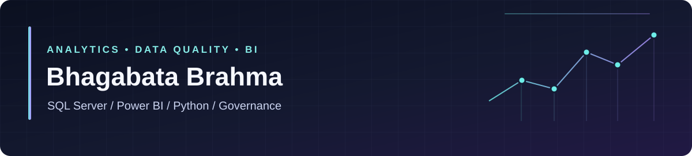

<div align="center">
  
</div>

# Hello, I'm Bhagabata Brahma 👋

**Data Analyst · Power BI Developer · Data Quality & Governance**

B.Tech in Computer Science & Engineering (2026) · Bengaluru, India

I turn complex, inconsistent data into **clear, dependable reporting**. My work spans SQL Server, Excel and Power Query, Python/pandas, Power BI and data-governance practices. I also work with Microsoft Dynamics 365 Finance & Operations (X++) through internship and trainee experience.

**Exploring early-career opportunities** in Data Analysis, Business Intelligence and Data Quality / Governance.

[**Featured projects**](#featured-projects) · [**Skills**](#technical-toolkit) · [**Experience**](#experience--education) · [**LinkedIn**](https://www.linkedin.com/in/bhagabata-brahma/) · [**Portfolio**](https://bhagabata-brahma-data-analyst.vercel.app/) · [**Email**](mailto:bhagabatabrahma0106@gmail.com)

---

## Featured projects

Projects below link to the actual source, reports and documentation. These are independent portfolio case studies; they are not claims of production deployment.

| Project | Stack | What to explore |
|---|---|---|
| **[UrbanCart — Sales & Customer Analytics](https://github.com/bhagabatabrahma0106-dotcom/UrbanCartAnalysis)** | Excel · SQL Server · Power BI | Five linked retail tables, sales KPIs, returns and channels, nine reporting views and data-quality controls |
| **[Pizza Sales Performance Analysis](https://github.com/bhagabatabrahma0106-dotcom/Pizza_Sales_Analysis)** | T-SQL · Power BI | Revenue, AOV, order patterns, category/size mix and best-selling products |
| **[EdTech App Market Analysis](https://github.com/bhagabatabrahma0106-dotcom/EdTech-Analysis)** | Python · pandas · SQL · Power BI | App installations, ratings and K-Means clustering, with notebooks and prepared datasets |
| **[SuperStore Data Management](https://github.com/bhagabatabrahma0106-dotcom/End-To-End-Data-Management)** | Python · SQL Server · Excel | Profiling, staging, transformation and reporting workflows with dashboard demonstration |
| **[Banking Transaction Analysis](https://github.com/bhagabatabrahma0106-dotcom/Python-Data_Anlysis)** | Python · Excel · SQL Server | Channel activity, transaction trends, data cleaning and risk indicators |
| **[Dynamics 365 F&O ERP Samples](https://github.com/bhagabatabrahma0106-dotcom/ERP-Reporting-Data-Analysis-using-Microsoft-Dynamics-365-F-O)** | X++ · Dynamics 365 F&O · SSRS | Development exports, reporting/customization examples and functional-design references |

**Also building:** [Interview Preparation Guide](https://github.com/bhagabatabrahma0106-dotcom/INTERVIEW-GUIDE) (React + TypeScript) · [Interactive Excel Learning Reference](https://github.com/bhagabatabrahma0106-dotcom/Excel-Advanced-Website) (React + TypeScript).

## Technical toolkit

| Area | Tools and practices |
|---|---|
| **SQL & data modeling** | Microsoft SQL Server, T-SQL, JOINs, CTEs, window functions, validation and reporting views |
| **Business intelligence** | Power BI Desktop, DAX, Power Query, KPI design, interactive report development |
| **Data analysis** | Python, pandas, NumPy, data cleaning, EDA and exploratory clustering |
| **Spreadsheets** | Advanced Excel, PivotTables, XLOOKUP, SUMIFS, Google Sheets |
| **Data quality & governance** | Data profiling, deduplication, completeness checks, metadata, lineage, business glossaries and stewardship concepts |
| **ERP & engineering** | Dynamics 365 Finance & Operations, X++, Git/GitHub, introductory React and TypeScript |

## Experience & education

**Data Analyst Intern — Data Gyan** · *Oct 2025 – Feb 2026*  
Worked with B2B customer data, SQL validation and Power BI reporting. Résumé project highlights include profiling **5,000+ records**, removing **300+ duplicates** through cleaning workflows, and delivering **three Power BI reports**.

**Finance Operations / Dynamics 365 F&O Intern → Trainee — Gohra Technologies** · *Oct 2025 – present*  
Experience with X++, application metadata and finance workflows, including treasury-related data structures, lifecycle processes and reconciliation-focused reporting. Completed an initial internship period before moving into training.

**B.Tech — Computer Science & Engineering** · *Satyasai Engineering College, BPUT · 2022–2026 · CGPA 8.04*

## How I approach data work

```text
Understand the business question
          ↓
Profile source data and document assumptions
          ↓
Clean, validate and model using Excel / Python / SQL
          ↓
Create reproducible metrics and Power BI views
          ↓
Explain findings, quality limitations and next steps
```

I care about **traceability, maintainability and honest documentation**. My repositories distinguish the source files that are available from the tools or environments still needed to reproduce an analysis.

## Currently exploring

- SQL Server query optimization and practical data-modeling patterns
- Power BI / DAX modeling and trustworthy KPI design
- Data governance, metadata and lineage
- Better tests, READMEs and reproducible analytics pipelines

## Connect

I'm interested in thoughtful conversations about analytics projects, junior analyst opportunities, BI reporting and data quality.

**[LinkedIn](https://www.linkedin.com/in/bhagabata-brahma/)** · **[Portfolio](https://bhagabata-brahma-data-analyst.vercel.app/)** · **[Email](mailto:bhagabatabrahma0106@gmail.com)**

<sub>This profile highlights work evidenced by my résumé and public repositories. Some dashboards require local SQL Server or Power BI connections for complete reproduction. No fabricated years of professional experience or unverified certifications are claimed.</sub>
