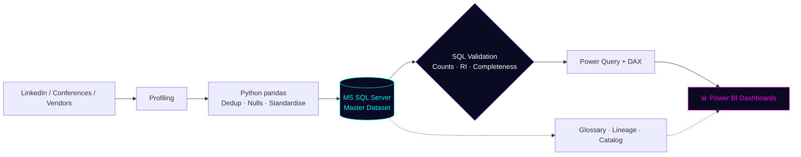

<div align="center">


<a href="https://github.com/bhagabatabrahma0106-dotcom">
  
</a>

<br/>


<br/>

<a href="https://linkedin.com/in/bhagabata-brahma"></a>
<a href="mailto:bhagabatabrahma0106@gmail.com"></a>
<a href="https://jerry-s-portfolio-web.vercel.app"></a>

</div>


## `> whoami`

```yaml
name:        Bhagabata Brahma
role:        Data Analyst | Power BI Developer | Data Governance Analyst
base:        Whitefield, Bengaluru, KA
education:   B.Tech CSE (2022-2026) @ SSEC / BPUT  ::  CGPA 8.04
languages:   [Odia (native), English (professional)]
status:      Available immediately  ->  full-time
mission:     "Data only becomes insight when someone trusts it enough to act on it."
```

I build **end-to-end data pipelines** that go from messy multi-source records to **governed, dashboard-ready datasets**: SQL for extraction and validation, Power BI + DAX for live KPIs, Python for automation, and **DAMA-DMBOK-aligned governance** (stewardship, lineage, glossary, catalog) to keep everything trustworthy.


## `> system.stack`

<div align="center">

| MODULE | TECHNOLOGIES |
|:--|:--|
| 🗄️ **Database** |  `JOINs` `CTEs` `Window Functions` `Subqueries` `Stored Procs` `Validation Scripts` |
| 📊 **BI & Viz** |  `DAX` `Power Query (M)` `Data Modelling` `KPI Reports` |
| 🐍 **Python** |   `Cleaning` `Dedup` `Automation` |
| 📑 **Spreadsheets** |   `XLOOKUP` `SUMIFS` `Pivot` `QUERY` `ARRAYFORMULA` |
| 🛡️ **Governance** | `DAMA-DMBOK` `Stewardship` `Metadata Mgmt` `Data Lineage` `Business Glossary` `Data Catalog` `Data Quality` `Lifecycle Mgmt` |
| 🧰 **Tools** |    `SSMS` `PowerPoint` |

</div>


## `> experience.log`

### 🟣 Data Analyst Intern · **Data Gyan**, Bengaluru
`Oct 2025 – Feb 2026` &nbsp;|&nbsp; *Data Management & Business Intelligence · B2B Customer Data · Marketing Analytics*

```diff
+ REQUIREMENTS   Ran stakeholder sessions to define scope, KPIs & deliverables across 3 project phases
+ DATA           Sourced & profiled 5,000+ B2B records (LinkedIn, conferences, vendor DBs) into 3 segments
+ SQL            Authored 20+ optimised queries (JOINs, CTEs, CASE, aggregations) -> unified master dataset
+ BI             Built & published 3 Power BI reports: Power Query (M) + DAX for lead, conversion & reach KPIs
+ SPREADSHEETS   Designed 5 templates (VLOOKUP, SUMIFS, ARRAYFORMULA, QUERY) to cut manual prep effort
+ PYTHON         pandas automation: deduplication, null handling, standardisation -> 300+ duplicates removed
+ GOVERNANCE     Ownership mapping, stewardship workflows & lifecycle classification (DAMA-DMBOK)
+ CATALOG        Business glossary (15+ terms), lineage ingestion -> Power BI, 12 assets tagged with metadata
+ QUALITY        Resolved 6 categories of issues; pre/post-load SQL validation -> 98%+ accuracy
```


## `> pipeline.architecture`




## `> impact.metrics`

<div align="center">

| 5,000+ | 20+ | 3 | 300+ | 98%+ | 15+ |
|:-:|:-:|:-:|:-:|:-:|:-:|
| records profiled | SQL queries | Power BI reports | duplicates removed | data accuracy | glossary terms |

</div>


## `> projects.index`

<div align="center">

<a href="https://github.com/bhagabatabrahma0106-dotcom/End-To-End-Data-Management">

</a>
<a href="https://github.com/bhagabatabrahma0106-dotcom/sql-sales-analysis">

</a>
<br/>
<a href="https://github.com/bhagabatabrahma0106-dotcom/Excel-Adv.--Data-Analysis">

</a>
<a href="https://github.com/bhagabatabrahma0106-dotcom/Python-Data_Anlysis">

</a>

</div>

| Project | Stack | Focus |
|:--|:--|:--|
| **End-To-End Data Management** | SQL Server · Power BI · Python · Sheets | Multi-source ingestion -> governed master dataset -> KPI dashboards |
| **SQL Sales Analysis** | SQL Server | KPI calculation & sales performance querying |
| **Excel Advanced Analysis** | Excel | HR payroll & performance analytics modelling |
| **Python Data Analysis** | Python · pandas · NumPy | Cleaning & analysis notebooks |
| **EdTech Analysis** | Python · Jupyter | EdTech domain analytics |


## `> education.db`

| Level | Institution | Result |
|:--|:--|:--|
| 🎓 **B.Tech, Computer Science & Engineering** (2022–2026) | Satyasai Engineering College · BPUT, Odisha | **CGPA 8.04** · DBMS (A) · Python Programming (O) |
| 📘 **Intermediate +2, Science** (2022) | CHSE, Odisha | 77% |

**Training:** Power BI & DAX · SQL for Data Analysis · Python for Data Analysis · Data Governance Fundamentals (DAMA-DMBOK) · Google Sheets Advanced Analytics


## `> telemetry`

<div align="center">


</div>


## `> roadmap.next`

```yaml
learning:
  - Advanced SQL query optimisation
  - Deeper DAX & data modelling patterns
  - Data mesh architecture & DAMA-DMBOK updates
building:
  - SQL interview Q&A master repository
  - Personal portfolio site
open_to:
  - Data Analyst
  - Power BI Developer
  - Data Governance Analyst
```

<div align="center">

### `> ping me`

<a href="mailto:bhagabatabrahma0106@gmail.com"></a>
<a href="https://linkedin.com/in/bhagabata-brahma"></a>


</div>
