

  <a href="https://bhagabata-brahma-data-analyst.vercel.app/" title="Open Bhagabata Brahma's portfolio">
    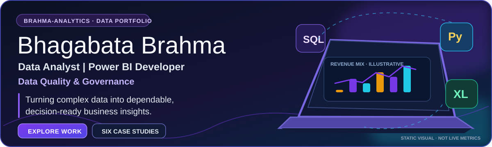
  </a>

  
<strong>Data Analyst · Power BI Developer · Data Quality & Governance</strong>

  
SQL Server & T-SQL · Power BI & DAX · Excel · Python · Data Quality · Dynamics 365 F&O

  

    <a href="#featured-projects"><strong>Featured projects</strong></a> ·
    <a href="#technology-stack">Technology stack</a> ·
    <a href="#experience--education">Experience</a> ·
    <a href="https://www.linkedin.com/in/bhagabata-brahma/">LinkedIn</a> ·
    <a href="https://bhagabata-brahma-data-analyst.vercel.app/">Portfolio</a> ·
    <a href="mailto:bhagabatabrahma0106@gmail.com">Email</a>
  

## 👋 About me

I'm **Bhagabata Brahma**, a Computer Science & Engineering graduate focused on building **clear, dependable and explainable analytics**. My project work covers SQL Server, Power BI, DAX, Power Query, Excel and Python. I also explore data quality, governance, metadata and **Microsoft Dynamics 365 Finance & Operations (X++)**.

I enjoy translating business questions into structured datasets, validated metrics, and reporting that people can understand and act on. My repositories document what was built, what is reproducible and what still requires a local tool or environment.

**Professional focus:** Early-career opportunities in **Data Analysis, Business Intelligence, Power BI reporting and Data Quality / Governance**.

## 🔄 Analytics workflow

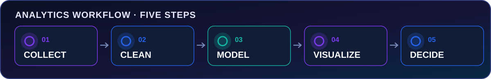

<strong>Watch the optional data-flow animation</strong>

This short animation is illustrative, not live business data. The static workflow above contains the full stage labels and remains readable without motion.

**Collect → Clean → Model → Visualize → Decide.** I connect the business question to source-data quality, transparent transformations, useful metrics and a clear decision narrative.

## 🧰 Technology stack

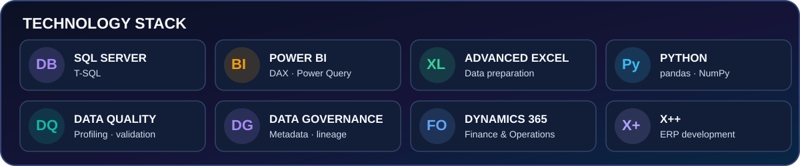

| Specialization | Technologies and practices |
|---|---|
| **Databases & SQL** | Microsoft SQL Server, T-SQL, joins, CTEs, window functions, views and query validation |
| **Business intelligence** | Power BI Desktop, DAX, Power Query, data modeling, reports and KPI definitions |
| **Spreadsheets** | Advanced Excel, PivotTables, XLOOKUP, SUMIFS, data cleanup and reporting |
| **Python analytics** | Python, pandas, NumPy, Matplotlib, Jupyter and exploratory analysis |
| **Data quality & governance** | Profiling, completeness, deduplication, metadata, lineage and stewardship concepts |
| **ERP development** | Dynamics 365 Finance & Operations, X++ artifacts, SSRS concepts and functional design |

## 🚀 Featured projects

**Six independent portfolio case studies.** The charts on these cards are original *illustrative artwork*, not screenshots of verified running dashboards. Each card links to an accessible source repository; documentation links lead to actual files. No unverified live demo is claimed.

### 01 · UrbanCart — Retail Analytics

<a href="https://github.com/bhagabatabrahma0106-dotcom/UrbanCartAnalysis" title="UrbanCart source repository">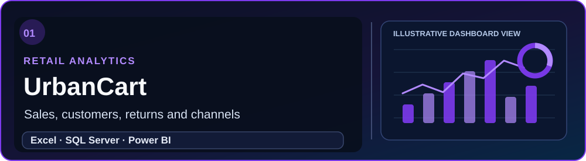</a>

**Sales, customers, returns and channels** using a **synthetic retail dataset**, SQL reporting views and a Power BI report package. Data-quality concerns and local refresh dependencies are documented.

**[Source code](https://github.com/bhagabatabrahma0106-dotcom/UrbanCartAnalysis)** · **[Setup & documentation](https://github.com/bhagabatabrahma0106-dotcom/UrbanCartAnalysis/blob/main/docs/SETUP.md)**

### 02 · Pizza Sales — Performance Analysis

<a href="https://github.com/bhagabatabrahma0106-dotcom/Pizza_Sales_Analysis" title="Pizza Sales source repository">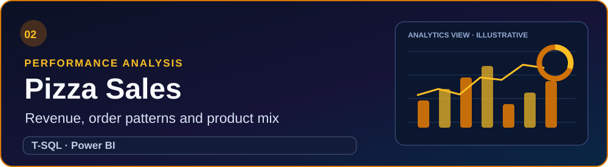</a>

Analyzes **sales value, orders, product performance and category/size mix** using transactional CSV data, T-SQL analysis and a Power BI report.

**[Source code](https://github.com/bhagabatabrahma0106-dotcom/Pizza_Sales_Analysis)** · **[Reproduction guide](https://github.com/bhagabatabrahma0106-dotcom/Pizza_Sales_Analysis/blob/main/docs/REPRODUCTION.md)**

### 03 · EdTech App — Market Analysis

<a href="https://github.com/bhagabatabrahma0106-dotcom/EdTech-Analysis" title="EdTech App source repository">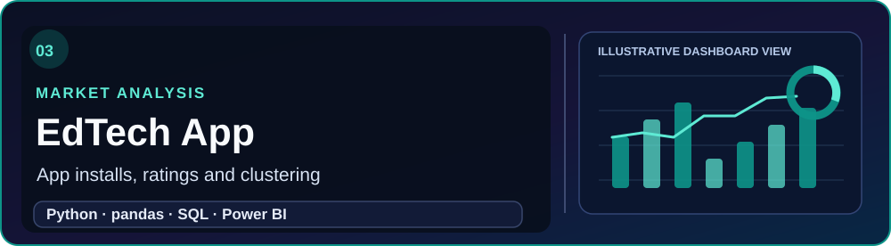</a>

Explores a **historical sample of education-related mobile apps** through installs, reviews, ratings, Python visualizations, K-Means clustering and SQL reporting.

**[Source code](https://github.com/bhagabatabrahma0106-dotcom/EdTech-Analysis)** · **[Reproduction guide](https://github.com/bhagabatabrahma0106-dotcom/EdTech-Analysis/blob/main/docs/REPRODUCTION.md)**

### 04 · SuperStore — Data Management

<a href="https://github.com/bhagabatabrahma0106-dotcom/End-To-End-Data-Management" title="SuperStore source repository">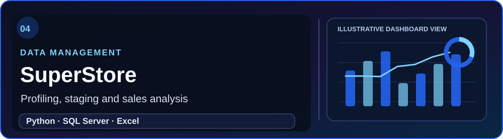</a>

Documents an **extract → clean → model → analyze** workflow using Excel/CSV, a Python notebook and SQL Server. The repository provides a **dashboard image and recorded demonstration**, not an editable dashboard file.

**[Source code](https://github.com/bhagabatabrahma0106-dotcom/End-To-End-Data-Management)** · **[Reproduction guide](https://github.com/bhagabatabrahma0106-dotcom/End-To-End-Data-Management/blob/main/docs/REPRODUCTION.md)** · **[Recorded dashboard walkthrough](https://github.com/bhagabatabrahma0106-dotcom/End-To-End-Data-Management/blob/main/assets/DataManagement_DashboardLiveVideo.mp4)**

### 05 · Banking Transaction Analysis

<a href="https://github.com/bhagabatabrahma0106-dotcom/Python-Data_Anlysis" title="Banking Transaction Analysis source repository">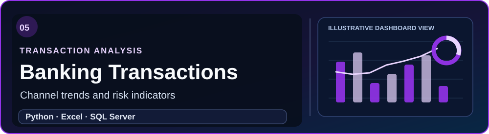</a>

Examines **transaction types, channels, monthly patterns and exploratory risk indicators**. The sample-based analysis does not claim fraud detection or production deployment.

**[Source code](https://github.com/bhagabatabrahma0106-dotcom/Python-Data_Anlysis)** · **[Reproduction guide](https://github.com/bhagabatabrahma0106-dotcom/Python-Data_Anlysis/blob/main/docs/REPRODUCTION.md)**

### 06 · Dynamics 365 F&O — ERP Samples

<a href="https://github.com/bhagabatabrahma0106-dotcom/ERP-Reporting-Data-Analysis-using-Microsoft-Dynamics-365-F-O" title="Dynamics 365 F&O source repository">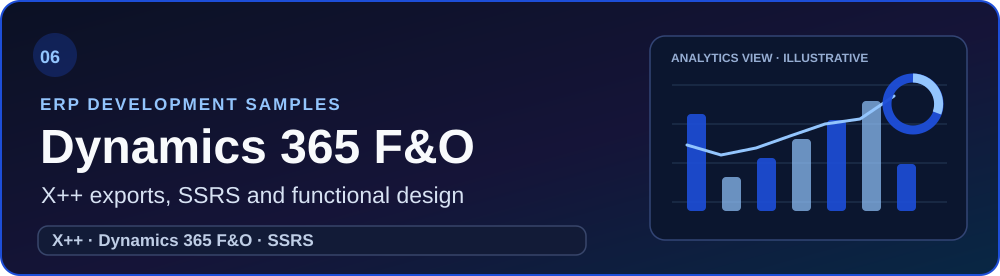</a>

A collection of **Dynamics 365 Finance & Operations / X++ exports**, reporting-related material, customization examples and a functional design reference. Imports, compilation and deployment require an authorized F&O sandbox.

**[Source code](https://github.com/bhagabatabrahma0106-dotcom/ERP-Reporting-Data-Analysis-using-Microsoft-Dynamics-365-F-O)** · **[Setup & review](https://github.com/bhagabatabrahma0106-dotcom/ERP-Reporting-Data-Analysis-using-Microsoft-Dynamics-365-F-O/blob/main/docs/SETUP_AND_REVIEW.md)**

<strong>Compare all six projects by stack and scope</strong>

| Project | Stack | Evidence available |
|---|---|---|
| UrbanCart | Excel · SQL Server · Power BI | Synthetic retail data, SQL views, PBIX and documentation |
| Pizza Sales | T-SQL · Power BI | Transactional CSV, T-SQL, PBIX and report guide |
| EdTech App | Python · pandas · SQL · Power BI | Notebook, sample CSV, clustering outputs, PBIX |
| SuperStore | Python · SQL Server · Excel | Notebook, SQL, dashboard screenshot and video |
| Banking Transactions | Python · Excel · SQL Server | Notebook, sample workbook and T-SQL |
| Dynamics 365 F&O | X++ · Dynamics 365 F&O · SSRS | .axpp exports, design document and review notes |

**More learning projects:** [Interview Preparation Guide](https://github.com/bhagabatabrahma0106-dotcom/INTERVIEW-GUIDE) · [Advanced Excel Learning Reference](https://github.com/bhagabatabrahma0106-dotcom/Excel-Advanced-Website) · [All GitHub repositories](https://github.com/bhagabatabrahma0106-dotcom?tab=repositories).

## 🛠️ Technical toolkit

My day-to-day analytical toolkit combines **SQL analysis**, **BI data modeling**, **Excel preparation**, **Python exploration**, and **documented data-quality checks**. Git and GitHub support versioning and reproducibility; Dynamics 365 F&O and X++ are a separate ERP development skill area.

**Representative activities:** writing readable SQL queries, reconciling source and output totals, shaping Power Query transformations, defining DAX measures, checking missing/duplicate records and documenting assumptions.

## 🎯 How I approach data work

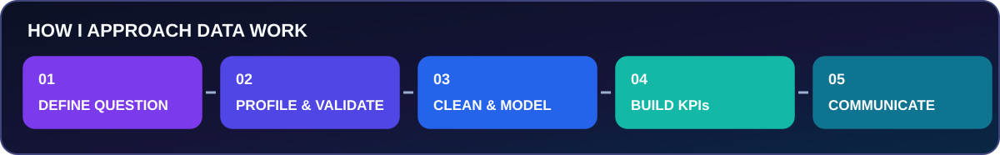

1. **Define the question:** Clarify stakeholders, decisions, metric definitions and reporting grain.
2. **Profile and validate:** Review completeness, types, duplicates, outliers and source limitations.
3. **Clean and model:** Prepare data with SQL, Excel / Power Query or Python; describe transformations.
4. **Build useful KPIs:** Create explainable measures and visuals, and check them against source totals.
5. **Communicate insights:** Present findings, caveats and recommended next steps without overclaiming.

## 🎓 Experience & education

**Data Analyst Intern — Data Gyan** · *Oct 2025 – Feb 2026*  
Worked with B2B customer data, SQL validation and Power BI reporting. The existing résumé-backed project summary describes profiling **5,000+ records**, removing **300+ duplicates** through cleaning workflows and preparing **three Power BI reports**.

**Finance Operations / Dynamics 365 F&O Intern → Trainee — Gohra Technologies** · *Oct 2025 – present (as listed in the source README)*  
Hands-on with **X++**, application metadata, Dynamics 365 F&O finance workflows, treasury-related data structures and reconciliation-oriented reporting. Environment-specific implementation is not represented as a public deployed client system.

**B.Tech — Computer Science & Engineering** · *Satyasai Engineering College, BPUT · 2022–2026 · CGPA 8.04*

## 📚 Currently exploring

- SQL Server query optimization, relational modeling and efficient reporting queries
- Advanced DAX, Power BI semantic models and trustworthy KPI design
- Data governance, metadata, lineage and data quality practices
- Reproducible analytics projects, tests and clearer project READMEs

## 📊 GitHub activity

<a href="https://github.com/bhagabatabrahma0106-dotcom" title="Open the actual GitHub contribution and repository activity">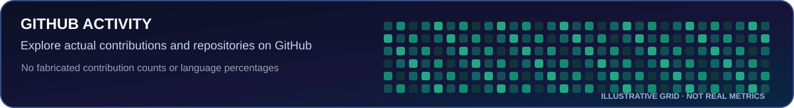</a>

For **actual commits, contributions, repository activity and pinned projects**, visit my [GitHub profile](https://github.com/bhagabatabrahma0106-dotcom). The graphic above does **not** represent measured activity.

## 🤝 Let's connect

I'm open to conversations about **Data Analyst**, **Power BI / BI reporting**, **SQL** and **Data Quality & Governance** roles.

**[LinkedIn](https://www.linkedin.com/in/bhagabata-brahma/)** · **[Portfolio](https://bhagabata-brahma-data-analyst.vercel.app/)** · **[Email](mailto:bhagabatabrahma0106@gmail.com)**

Portfolio case studies and decorative chart graphics are not production performance claims. SQL Server, Power BI, Dynamics 365 F&O, Tableau and Python projects may require local software, data-source configuration or runtime checks that static GitHub validation cannot provide. See the <a href="design/figma-handoff.md">Figma-ready handoff</a> and <a href="design/responsive-spec.md">responsive design notes</a> for the implementation specification.
